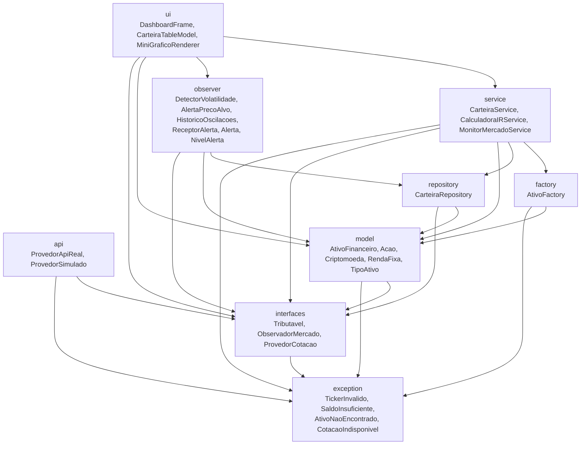
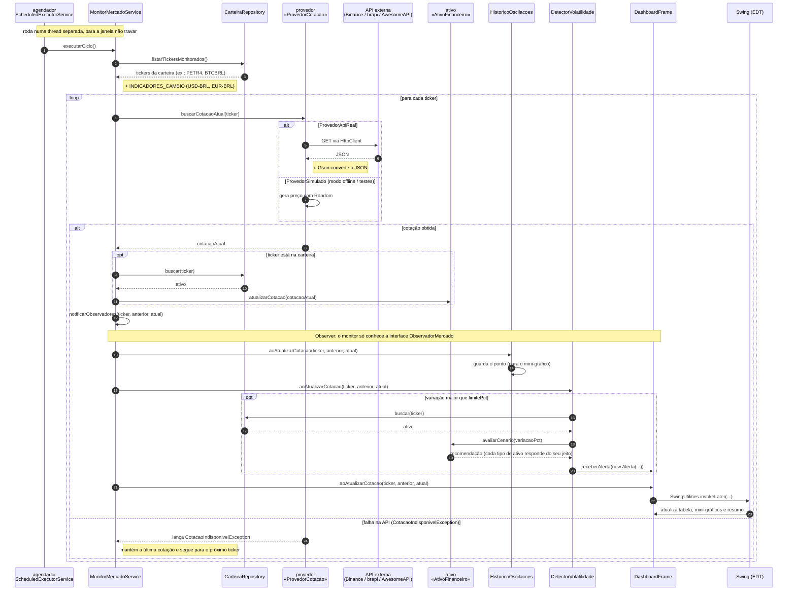
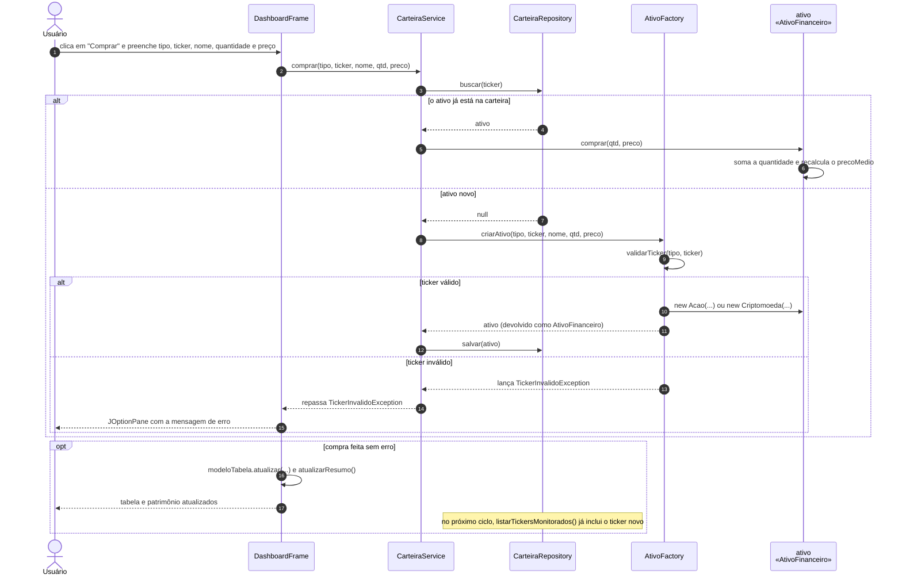

# InvestTrack — Diagramas UML

Feitos em **Mermaid** (uma das ferramentas indicadas na Aula 08). O GitHub desenha os blocos
abaixo direto nesta página. Os arquivos `.mmd` têm o código de cada diagrama e os `.png` são as
imagens para os slides.

> **Regra da dupla:** mudou o nome de uma classe, atributo ou método no código? Mude aqui também.
> O professor avalia se os diagramas estão **coerentes com o código** (2,0 pontos).

## Como ler (notação da Aula 08)

| No diagrama | Significado |
|---|---|
| `- nome: Tipo` / `+ metodo(p: Tipo): Retorno` | `-` privado, `+` público, `#` protegido; em UML o tipo vem **depois** |
| texto <u>sublinhado</u> | membro `static` |
| texto *em itálico* | método `abstract` |
| linha contínua com triângulo vazado | **herança** (`extends`) |
| linha tracejada com triângulo vazado | **implementação** (`implements`) |
| linha contínua com seta | **associação**: a classe guarda a outra num atributo |
| linha tracejada com seta | **relação momentânea**: a outra classe só aparece como parâmetro, variável local ou retorno |
| losango vazado | **agregação**: a parte é criada fora e chega por parâmetro |
| losango cheio | **composição**: o próprio todo faz o `new` da parte |
| `1`, `0..1`, `*` | multiplicidade |

Getters e setters simples foram omitidos, como recomenda a Aula 08 ("poluem sem informar").

## 1. Diagrama de Classes — parte 1: domínio da carteira

Hierarquia dos ativos, tributação, criação (Factory), armazenamento (Singleton) e serviços.

```mermaid
classDiagram
    direction TB

    namespace model {
        class AtivoFinanceiro {
            <<abstract>>
            - ticker: String
            - nome: String
            - quantidade: double
            - precoMedio: double
            - cotacaoAtual: double
            + AtivoFinanceiro(ticker: String, nome: String, quantidade: double, precoMedio: double)
            + atualizarCotacao(novaCotacao: double) void
            + comprar(quantidade: double, preco: double) void
            + vender(quantidade: double) void
            + calcularValorAtual() double
            + calcularLucroPrejuizo() double
            + calcularRendimentoProjetado(meses: int)* double
            + avaliarCenario(variacaoPct: double)* String
        }
        class Acao {
            - dividendYieldAnual: double
            + Acao(ticker: String, nome: String, quantidade: double, precoMedio: double, dividendYieldAnual: double)
            + calcularRendimentoProjetado(meses: int) double
            + avaliarCenario(variacaoPct: double) String
            + calcularImposto() double
        }
        class Criptomoeda {
            + Criptomoeda(ticker: String, nome: String, quantidade: double, precoMedio: double)
            + calcularRendimentoProjetado(meses: int) double
            + avaliarCenario(variacaoPct: double) String
            + calcularImposto() double
        }
        class RendaFixa {
            - taxaAnual: double
            - dataAplicacao: LocalDate
            - dataVencimento: LocalDate
            + RendaFixa(nome: String, valor: double, taxaAnual: double, dataVencimento: LocalDate)
            + investir(valor: double) void
            + resgatar(valor: double) void
            + calcularAliquotaIR() double
            + isAntesDoVencimento() boolean
            + calcularRendimentoProjetado(meses: int) double
            + avaliarCenario(variacaoPct: double) String
            + calcularImposto() double
        }
        class TipoAtivo {
            <<enumeration>>
            ACAO
            CRIPTOMOEDA
            RENDA_FIXA
        }
    }

    namespace interfaces {
        class Tributavel {
            <<interface>>
            + calcularImposto() double
        }
    }

    namespace factory {
        class AtivoFactory {
            + criarRendaFixa(nome: String, valor: double, taxaAnual: double, vencimento: LocalDate)$ RendaFixa
            + criarAtivo(tipo: TipoAtivo, ticker: String, nome: String, qtd: double, preco: double)$ AtivoFinanceiro
            - validarTicker(tipo: TipoAtivo, ticker: String)$ void
        }
    }

    namespace repository {
        class CarteiraRepository {
            <<Singleton>>
            - instancia: CarteiraRepository$
            - ativos: ConcurrentHashMap~String, AtivoFinanceiro~
            - CarteiraRepository()
            + getInstancia()$ CarteiraRepository
            + salvar(ativo: AtivoFinanceiro) void
            + buscar(ticker: String) AtivoFinanceiro
            + remover(ticker: String) void
            + listarTodos() List~AtivoFinanceiro~
            + listarTickersMonitorados() Set~String~
            + listarTributaveis() List~Tributavel~
        }
    }

    namespace service {
        class CarteiraService {
            - repositorio: CarteiraRepository
            + CarteiraService(repositorio: CarteiraRepository)
            + comprar(tipo: TipoAtivo, ticker: String, nome: String, qtd: double, preco: double) void
            + vender(ticker: String, qtd: double) void
            + investirRendaFixa(nome: String, valor: double, taxaAnual: double, vencimento: LocalDate) void
            + resgatarRendaFixa(nome: String, valor: double) String
            + calcularPatrimonioTotal() double
            + calcularLucroPrejuizoTotal() double
        }
        class CalculadoraIRService {
            + calcularImpostoTotal(itens: List~Tributavel~) double
            + gerarRelatorio(itens: List~Tributavel~) String
        }
    }

    namespace exception {
        class TickerInvalidoException
        class SaldoInsuficienteException
        class AtivoNaoEncontradoException
        class CotacaoIndisponivelException
    }

    class Exception {
        <<Java>>
    }

    %% heranca: linha continua com triangulo vazado
    AtivoFinanceiro <|-- Acao
    AtivoFinanceiro <|-- Criptomoeda
    AtivoFinanceiro <|-- RendaFixa
    Exception <|-- TickerInvalidoException
    Exception <|-- SaldoInsuficienteException
    Exception <|-- AtivoNaoEncontradoException
    Exception <|-- CotacaoIndisponivelException

    %% implementacao: linha tracejada com triangulo vazado
    Tributavel <|.. Acao
    Tributavel <|.. Criptomoeda
    Tributavel <|.. RendaFixa

    %% agregacao: os ativos sao criados fora (AtivoFactory) e entram por salvar(ativo)
    CarteiraRepository "0..1" o-- "*" AtivoFinanceiro : ativos

    %% associacao: atributo recebido no construtor
    CarteiraService --> "1" CarteiraRepository : repositorio

    %% relacoes momentaneas (parametro, variavel local ou retorno): linha tracejada
    CarteiraService ..> AtivoFactory : pede a criação
    AtivoFactory ..> AtivoFinanceiro : cria e devolve
    AtivoFactory ..> TipoAtivo
    AtivoFactory ..> TickerInvalidoException : lança
    AtivoFinanceiro ..> SaldoInsuficienteException : lança em vender()
    CarteiraService ..> AtivoNaoEncontradoException : lança
    CalculadoraIRService ..> Tributavel : percorre a lista
```



## 2. Diagrama de Classes — parte 2: monitoramento, alertas e interface

Provedores de cotação (Strategy), monitor e observadores (Observer) e a interface em Swing.
`AtivoFinanceiro` e `CarteiraRepository` aparecem resumidos aqui; os detalhes estão na parte 1.

```mermaid
classDiagram
    direction TB

    namespace interfaces {
        class ProvedorCotacao {
            <<interface>>
            + buscarCotacaoAtual(ticker: String) double
        }
        class ObservadorMercado {
            <<interface>>
            + aoAtualizarCotacao(ticker: String, cotacaoAnterior: double, cotacaoAtual: double) void
        }
    }

    namespace api {
        class ProvedorApiReal {
            - cliente: HttpClient
            - gson: Gson
            + ProvedorApiReal()
            + buscarCotacaoAtual(ticker: String) double
            - buscarNaBinance(ticker: String) double
            - buscarNaBrapi(ticker: String) double
            - buscarNaAwesome(par: String) double
        }
        class ProvedorSimulado {
            - precos: Map~String, Double~
            - aleatorio: Random
            + ProvedorSimulado(semente: long)
            + definirPreco(ticker: String, preco: double) void
            + buscarCotacaoAtual(ticker: String) double
        }
    }

    namespace service {
        class MonitorMercadoService {
            - INDICADORES_CAMBIO: List~String~$
            - INTERVALO_SEGUNDOS: int$
            - provedor: ProvedorCotacao
            - repositorio: CarteiraRepository
            - observadores: List~ObservadorMercado~
            - ultimasCotacoes: Map~String, Double~
            - agendador: ScheduledExecutorService
            + MonitorMercadoService(provedor: ProvedorCotacao, repositorio: CarteiraRepository)
            + adicionarObservador(o: ObservadorMercado) void
            + removerObservador(o: ObservadorMercado) void
            + setProvedor(provedor: ProvedorCotacao) void
            + iniciar() void
            + parar() void
            + executarCiclo() void
            - notificarObservadores(ticker: String, anterior: double, atual: double) void
        }
    }

    namespace observer {
        class ReceptorAlerta {
            <<interface>>
            + receberAlerta(alerta: Alerta) void
        }
        class Alerta {
            - ticker: String
            - mensagem: String
            - nivel: NivelAlerta
            - horario: LocalDateTime
            + Alerta(ticker: String, mensagem: String, nivel: NivelAlerta)
        }
        class NivelAlerta {
            <<enumeration>>
            INFO
            ATENCAO
            CRITICO
        }
        class DetectorVolatilidade {
            - limitePct: double
            - repositorio: CarteiraRepository
            - receptor: ReceptorAlerta
            + DetectorVolatilidade(limitePct: double, repositorio: CarteiraRepository, receptor: ReceptorAlerta)
            + aoAtualizarCotacao(ticker: String, cotacaoAnterior: double, cotacaoAtual: double) void
        }
        class AlertaPrecoAlvo {
            - alvos: Map~String, Double~
            - receptor: ReceptorAlerta
            + AlertaPrecoAlvo(receptor: ReceptorAlerta)
            + definirAlvo(ticker: String, precoAlvo: double) void
            + aoAtualizarCotacao(ticker: String, cotacaoAnterior: double, cotacaoAtual: double) void
        }
        class HistoricoOscilacoes {
            - MAX_PONTOS: int$
            - historico: Map~String, Deque~Double~~
            + aoAtualizarCotacao(ticker: String, cotacaoAnterior: double, cotacaoAtual: double) void
            + listarHistorico(ticker: String) List~Double~
        }
    }

    namespace model {
        class AtivoFinanceiro {
            <<abstract>>
            + avaliarCenario(variacaoPct: double)* String
        }
    }

    namespace repository {
        class CarteiraRepository {
            <<Singleton>>
            + listarTickersMonitorados() Set~String~
            + buscar(ticker: String) AtivoFinanceiro
        }
    }

    namespace exception {
        class CotacaoIndisponivelException
    }

    namespace ui {
        class DashboardFrame {
            - carteiraService: CarteiraService
            - monitor: MonitorMercadoService
            - historico: HistoricoOscilacoes
            - modeloTabela: CarteiraTableModel
            - tabela: JTable
            - listaAlertas: DefaultListModel~String~
            - botaoModoSimulado: JToggleButton
            + DashboardFrame(carteiraService: CarteiraService, monitor: MonitorMercadoService, historico: HistoricoOscilacoes)
            + aoAtualizarCotacao(ticker: String, cotacaoAnterior: double, cotacaoAtual: double) void
            + receberAlerta(alerta: Alerta) void
            - alternarProvedor() void
            - abrirDialogoCompra() void
            - abrirDialogoVenda() void
            - atualizarResumo() void
        }
        class CarteiraTableModel {
            - ativos: List~AtivoFinanceiro~
            + atualizar(ativos: List~AtivoFinanceiro~) void
            + getRowCount() int
            + getColumnCount() int
            + getValueAt(linha: int, coluna: int) Object
        }
        class MiniGraficoRenderer {
            - historico: HistoricoOscilacoes
            + MiniGraficoRenderer(historico: HistoricoOscilacoes)
            + getTableCellRendererComponent(...) Component
            # paintComponent(g: Graphics) void
        }
    }

    class Main {
        + main(args: String[])$ void
    }
    class JFrame {
        <<Swing>>
    }
    class AbstractTableModel {
        <<Swing>>
    }
    class JPanel {
        <<Swing>>
    }
    class TableCellRenderer {
        <<interface>>
    }

    %% implementacao (linha tracejada com triangulo vazado)
    ProvedorCotacao <|.. ProvedorApiReal
    ProvedorCotacao <|.. ProvedorSimulado
    ObservadorMercado <|.. DetectorVolatilidade
    ObservadorMercado <|.. AlertaPrecoAlvo
    ObservadorMercado <|.. HistoricoOscilacoes
    ObservadorMercado <|.. DashboardFrame
    ReceptorAlerta <|.. DashboardFrame
    TableCellRenderer <|.. MiniGraficoRenderer

    %% heranca (linha continua com triangulo vazado)
    JFrame <|-- DashboardFrame
    AbstractTableModel <|-- CarteiraTableModel
    JPanel <|-- MiniGraficoRenderer

    %% Strategy: o provedor e um atributo trocado por setProvedor()
    MonitorMercadoService --> "1" ProvedorCotacao : provedor
    %% Observer: os observadores sao criados fora e entram por adicionarObservador()
    MonitorMercadoService "1" o-- "*" ObservadorMercado : observadores
    MonitorMercadoService --> "1" CarteiraRepository : repositorio

    %% associacoes (atributos recebidos no construtor)
    DetectorVolatilidade --> "1" ReceptorAlerta : receptor
    DetectorVolatilidade --> "1" CarteiraRepository : repositorio
    AlertaPrecoAlvo --> "1" ReceptorAlerta : receptor
    Alerta --> "1" NivelAlerta : nivel
    DashboardFrame --> "1" MonitorMercadoService : monitor
    DashboardFrame --> "1" HistoricoOscilacoes : historico
    MiniGraficoRenderer --> "1" HistoricoOscilacoes : historico

    %% composicao: o DashboardFrame faz o new do modelo da tabela
    DashboardFrame "1" *-- "1" CarteiraTableModel : modeloTabela
    %% agregacao: a lista de ativos vem de fora por atualizar(ativos)
    CarteiraTableModel "*" o-- "*" AtivoFinanceiro : ativos

    %% relacoes momentaneas (linha tracejada)
    DetectorVolatilidade ..> AtivoFinanceiro : avaliarCenario()
    DetectorVolatilidade ..> Alerta : cria
    AlertaPrecoAlvo ..> Alerta : cria
    DashboardFrame ..> MiniGraficoRenderer : cria
    ProvedorCotacao ..> CotacaoIndisponivelException : lança
    Main ..> DashboardFrame : cria e conecta tudo
```



## 3. Dependência entre pacotes

As setas seguem uma só direção: `model` só depende de `interfaces` e `exception`, e nenhum pacote
depende de `ui`. Por isso as regras da carteira e o monitor podem ser testados sem abrir janela.
O `Main` foi omitido do desenho porque ele conhece quase todos os pacotes só para montar o sistema.



## 4. Diagrama de Sequência — ciclo de monitoramento (a cada 15 segundos)

Setas cheias são chamadas e setas tracejadas são retornos.



## 5. Diagrama de Sequência — compra de um ativo



## Onde cada padrão aparece

| Padrão | Classes | Para quê |
|---|---|---|
| Singleton | `CarteiraRepository` | Uma única carteira, compartilhada pela tela e pela thread do monitor |
| Factory Method | `AtivoFactory` | Cria e valida os ativos num lugar só; um tipo novo (ex.: FII) não mexe em quem usa a fábrica |
| Observer | `MonitorMercadoService` + `ObservadorMercado` | A cada ciclo, o monitor avisa a tela, o histórico e os detectores sem conhecer nenhum deles |
| Strategy | `ProvedorCotacao` (`ProvedorApiReal` / `ProvedorSimulado`) | O botão da tela troca a fonte das cotações com o programa rodando (plano B se a internet cair) |

## Decisões tomadas nos diagramas

Pontos que não estavam no documento de contexto e foram definidos aqui:

- **`ObservadorMercado.aoAtualizarCotacao(ticker: String, cotacaoAnterior: double, cotacaoAtual: double)`**:
  recebe o ticker (e não o ativo) porque o dólar e o euro também são monitorados e não estão na carteira.
- **`ReceptorAlerta`, `Alerta` e `NivelAlerta` ficam no pacote `observer`**. Os detectores mandam o
  `Alerta` pela interface `ReceptorAlerta`, então não dependem do Swing. Ficaram em `observer` (e não em
  `interfaces`/`model`) para não criar um ciclo entre os pacotes `model` e `interfaces`.
- **`CarteiraService`** (pacote `service`) recebe as operações da tela: comprar, vender, investir e
  resgatar. A tela não mexe direto no repositório.
- **`CarteiraRepository.buscar(ticker)` devolve `null`** quando o ticker não existe. Quem lança
  `AtivoNaoEncontradoException` é o `CarteiraService` (por exemplo, ao vender algo que não tem).
- **Exceções personalizadas** herdam de `Exception` (verificadas): a tela é obrigada a tratar e mostrar
  a mensagem num `JOptionPane`.
- **`RendaFixa`** usa `investir` e `resgatar`; a alíquota de IR segue a tabela regressiva
  (22,5% até 180 dias, 20% até 360, 17,5% até 720 e 15% acima disso).
- **Métodos que calculam** (e não só devolvem um atributo) começam com `calcular` ou `listar`
  (`calcularValorAtual`, `calcularPatrimonioTotal`, `listarHistorico`), para não serem confundidos com getters.
- **`MonitorMercadoService.executarCiclo()` é público** para os testes chamarem um ciclo na hora,
  com o `ProvedorSimulado`, sem esperar 15 segundos nem depender da internet.

## Organização do código (mesmo padrão do `java-media-player` da Aula 12)

```
src/br/ufrn/imd/investtrack/
  Main.java
  package-info.java        visão geral das camadas (capa do JavaDoc)
  model/  interfaces/  factory/  repository/  service/  api/  observer/  ui/  exception/
                           (cada pacote com seu package-info.java)
src/tests/                 testes unitários
lib/                       gson.jar e junit-platform-console-standalone.jar
bin/                       .class gerados (no .gitignore)
doc/                       JavaDoc gerado (no .gitignore)
```
